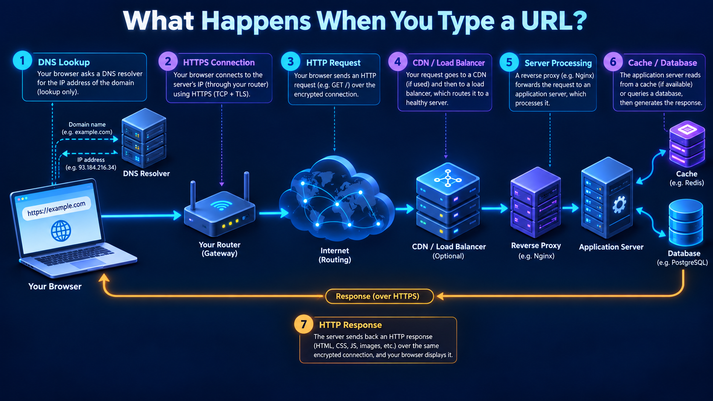
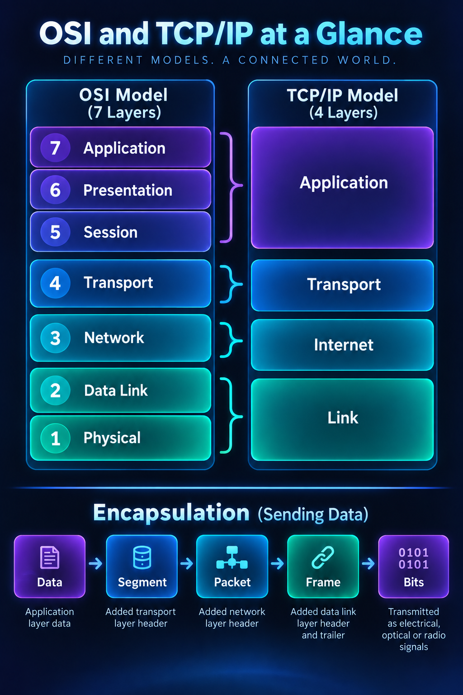
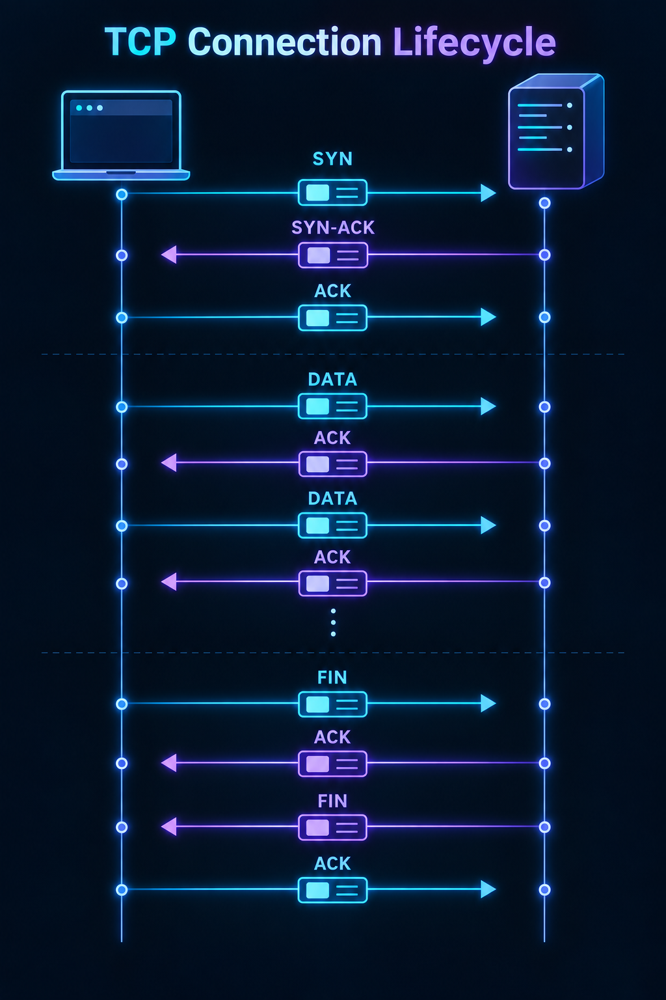

# Computer Networks Interview Preparation

This is a revision-first knowledge base for SDE, backend, systems, and networking interviews. Read the files in numeric order once, then revise by scenario and question bank.

## Learning path

| Stage | Files | Goal |
|---|---|---|
| Beginner | 01–09 | Learn layers, addressing, LAN, DNS, and routing |
| Core backend | 10–18 | Explain TCP, TLS, HTTP, QUIC, and sockets |
| System design | 19–24 | Design secure, scalable, debuggable services |
| Practice | 25 | Speak through exactly 100 interview questions |

## Visuals

## Quick interview answer pattern

**Definition → Why → How → Example → Trade-off.** Start with one accurate sentence, trace the flow, then add a real production example. State uncertainty or implementation variation explicitly; protocol behaviour often depends on version, operating system, and network policy.

> **Interview Tip:** Do not memorize isolated definitions. Trace one request from browser to service and name the layer solving each problem.

## Topic map

1. [Networking basics](01-networking-basics.md)
2. [Models and encapsulation](02-network-models.md)
3. [Physical and data-link layer](03-physical-data-link.md)
4. [Ethernet and MAC](04-ethernet-mac.md)
5. [IP addressing](05-ip-addressing.md)
6. [Subnetting and CIDR](06-subnetting-cidr.md)
7. [Routing](07-routing.md)
8. [ARP, ICMP, DHCP](08-arp-icmp-dhcp.md)
9. [DNS](09-dns.md)
10. [Transport layer](10-transport-layer.md)
11. [TCP](11-tcp.md)
12. [UDP and TCP vs UDP](12-udp-tcp-vs-udp.md)
13. [TCP setup and close](13-tcp-handshake-termination.md)
14. [Flow and congestion control](14-flow-congestion-control.md)
15. [HTTP](15-http.md)
16. [HTTPS and TLS](16-https-tls.md)
17. [HTTP/2, HTTP/3, QUIC](17-http2-http3-quic.md)
18. [WebSockets and sockets](18-websockets-sockets.md)
19. [Proxies, load balancers, CDN](19-proxies-load-balancers-cdn.md)
20. [NAT, firewalls, VPN](20-nat-firewalls-vpn.md)
21. [Network security](21-network-security.md)
22. [Troubleshooting](22-network-troubleshooting.md)
23. [What happens when you type a URL?](23-url-journey.md)
24. [Real-world and system design](24-real-world-system-design.md)
25. [100 interview questions](25-interview-questions.md)
