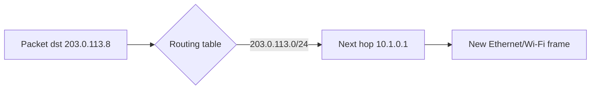

# Routing

## What is it?

Routing chooses the next hop for an IP packet. Routers use a forwarding table, populated by static configuration or routing protocols.

## Simple Explanation

It is a GPS decision at every junction: routers do not need the full journey in a packet; each router chooses its next road.

## Hinglish Explanation

Router destination IP dekhkar routing table mein best matching prefix find karta hai. Phir packet ko next hop bhej deta hai. Har router independently next decision leta hai.

## Why Do We Need It?

No single device can directly connect every network. Routing creates scalable paths and can adapt when links fail.

## How It Works

1. Router receives a link-layer frame and checks the IP packet.
2. It decrements TTL/Hop Limit; zero creates an ICMP error.
3. It uses longest-prefix match, then route metrics/policy where relevant.
4. It resolves the next-hop MAC and emits a new link frame.

## Important Components / Terminology

| Term | Meaning |
|---|---|
| Default route | Catch-all route, often `0.0.0.0/0` |
| Next hop | Immediate router/peer to receive the packet |
| Metric | Relative path preference |
| Static route | Manually configured route |
| Dynamic routing | Routers exchange reachability information |

## Example

`ip route get 8.8.8.8` on Linux asks the kernel which local interface, source address, and gateway it would use.

## Real-World Example

Data centres commonly use equal-cost multipath (ECMP). Hashing may keep a flow on one path while different flows take different equal-cost paths.

## Important Properties

| Routing style | Advantage | Trade-off |
|---|---|---|
| Static | Predictable/simple | Manual maintenance |
| Dynamic | Adapts to change | More complexity/convergence |
| ECMP | Uses parallel links | Per-flow imbalance possible |

### Common Misconceptions

* Routers forward based on destination IP, not TCP port in ordinary routing.
* Routing is not DNS; DNS maps names to addresses.
* A route existing does not prove ACLs or firewalls permit traffic.

### What Interviewers Usually Test

The packet-by-packet path, longest-prefix matching, default routes, and diagnosis of black holes.

### Common Follow-up Questions

1. Why does traceroute reveal hops?
2. What is ECMP?
3. What is a routing loop?
4. How is a route different from a firewall rule?
5. What is BGP broadly used for?

### Follow-up Answers

1. Traceroute sends packets with increasing TTL/Hop Limit values; routers where the value expires may return ICMP Time Exceeded.
2. ECMP uses several equal-cost routes and usually hashes each flow onto one path to share capacity while preserving ordering.
3. A routing loop occurs when routers keep forwarding a packet among themselves; TTL/Hop Limit eventually stops it.
4. A route says where a packet should go; a firewall rule says whether traffic is allowed to go there.
5. BGP exchanges reachability and routing policy between autonomous systems, including on the public Internet.
