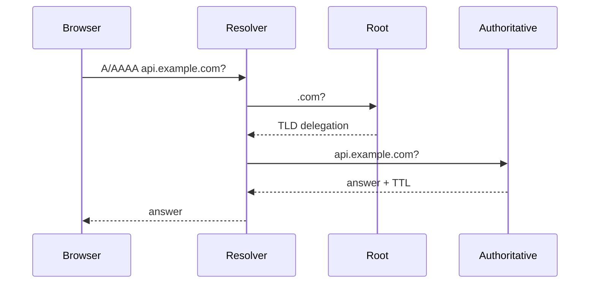

# DNS (Domain Name System)

## What is it?

DNS translates names such as `api.example.com` into records such as IP addresses. It is a distributed, cached naming system—not a central phone book.

## Simple Explanation

DNS is like asking a directory service for a company’s address before sending a parcel. Your device often asks a recursive resolver, which obtains and caches the answer.

## Hinglish Explanation

Browser ko `example.com` ka IP chahiye. Woh pehle local cache, phir configured resolver ko check karta hai. Resolver root, TLD aur authoritative DNS se answer dhoondh sakta hai aur TTL tak cache karta hai.

## Why Do We Need It?

Names are stable and human-friendly while service IPs can change. DNS also supports aliases, mail routing, service discovery patterns, and traffic steering.

## How It Works

1. Browser/OS checks its caches and possibly hosts file.
2. It queries a recursive resolver.
3. On a miss, resolver follows delegations: root → TLD → authoritative server.
4. It returns an answer and caches it according to TTL; the client connects to the returned endpoint.

## Important Components / Terminology

| Term | Meaning |
|---|---|
| Recursive resolver | Gets an answer for the client, often using cache |
| Authoritative server | Source of record data for a zone |
| TTL | Cache lifetime, not a guaranteed instant update |
| A / AAAA | IPv4 / IPv6 address record |
| CNAME | Alias to another DNS name |
| NXDOMAIN | Name does not exist; may be negatively cached |

## Example

`dig api.example.com A` shows the answer and TTL. `dig +trace example.com` illustrates delegation, while `nslookup` is a common cross-platform quick check.

## Real-World Example

CDNs return location-aware or load-aware answers. A deployment must respect existing TTLs, resolver caching, and connection reuse; DNS changes are not an instantaneous global switch.

## Important Properties

| Transport | DNS use |
|---|---|
| UDP/53 | Common ordinary queries |
| TCP/53 | Large/truncated answers, zone transfers, fallback |
| DoH/DoT | DNS protected by HTTPS/TLS in applicable setups |

### Common Misconceptions

* DNS does not always use UDP.
* DNS resolution proves neither TCP reachability nor application health.
* A CNAME is not an HTTP redirect.

### What Interviewers Usually Test

Resolver versus authoritative roles, caching, record types, and debugging a name that “does not work.”

### Common Follow-up Questions

1. A versus AAAA versus CNAME?
2. What does TTL control?
3. Why may DNS updates appear delayed?
4. DNS versus service discovery?
5. How does DNS load balancing differ from an L7 balancer?

### Follow-up Answers

1. `A` returns an IPv4 address, `AAAA` returns an IPv6 address, and `CNAME` aliases one hostname to another hostname.
2. TTL tells caches how long they may reuse a DNS answer before they should ask again.
3. Different caches may still hold the old answer until their TTL expires, and existing client connections may keep using old endpoints.
4. DNS maps names to records; service discovery additionally manages dynamic instance membership, health, metadata, and selection.
5. DNS chooses an address before a connection; an L7 load balancer chooses/reroutes an HTTP request after it reaches the balancing layer.
