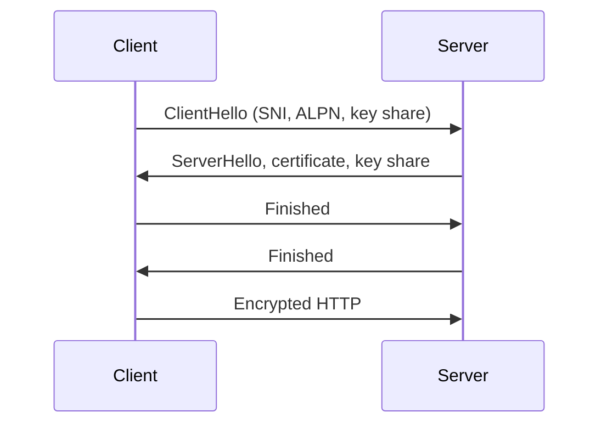

# HTTPS and TLS

## What is it?

HTTPS is HTTP carried over TLS. TLS authenticates the server (and optionally client), negotiates encryption, and protects data integrity in transit.

## Simple Explanation

HTTPS puts an authenticated, tamper-evident locked tunnel around an HTTP conversation. The website can still see its own HTTP data; this is not anonymity from the server.

## Hinglish Explanation

HTTPS koi separate application protocol nahi—HTTP over TLS hai. Certificate se client server identity verify karta hai, keys negotiate hoti hain, phir HTTP data encrypted and integrity-protected channel mein jaata hai.

## Why Do We Need It?

Without protection, on-path attackers may read or alter credentials, cookies, payments, and API data. TLS also prevents many impersonation attacks when certificate validation is correct.

## How It Works

1. Client starts TLS and offers supported versions/ciphers plus SNI/ALPN where applicable.
2. Server returns certificate chain and key-exchange information.
3. Client validates hostname, validity, trust chain, and policy.
4. Both derive symmetric session keys; encrypted HTTP follows.

## Important Components / Terminology

| Term | Meaning |
|---|---|
| Certificate | Binds a public key to identity assertions |
| CA | Certificate authority trusted by clients |
| SNI | Server Name Indication for virtual hosting |
| ALPN | Negotiates application protocol, e.g. h2 |
| Forward secrecy | Compromise of long-term key need not expose old sessions |

## Example

`curl -v https://example.com` displays TLS negotiation. `openssl s_client -connect host:443 -servername host` helps inspect a presented certificate and SNI behaviour.

## Real-World Example

A load balancer may terminate TLS and send private-network HTTP to an app, or re-encrypt to backend. The trust boundary, certificate handling, and internal network controls must match the threat model.

## Important Properties

| Property | TLS contribution |
|---|---|
| Confidentiality | Encrypts application data |
| Integrity | Detects modification |
| Authentication | Usually authenticates server |
| Availability | Does not prevent DDoS by itself |

### Common Misconceptions

* TLS is not only “encryption”; identity validation matters.
* A padlock does not prove a site is honest—only that TLS to that domain validated.
* TLS does not encrypt IP addresses or all connection metadata.

### What Interviewers Usually Test

Certificate validation, handshake purpose, TLS termination, and the difference between HTTP and HTTPS.

### Common Follow-up Questions

1. What causes a certificate error?
2. Why is SNI needed?
3. TLS termination versus passthrough?
4. Symmetric versus asymmetric crypto role?
5. What does mTLS add?

### Follow-up Answers

1. Common causes are wrong hostname, expired/not-yet-valid certificate, untrusted issuer, incomplete chain, revocation/policy failure, or incorrect client clock.
2. SNI tells the server the intended hostname early in TLS so shared-IP virtual hosts can present the right certificate.
3. Termination decrypts TLS at a proxy; passthrough forwards encrypted TLS to the backend, limiting front-proxy HTTP visibility.
4. Asymmetric cryptography/certificates help authenticate and agree keys; symmetric cryptography efficiently protects the bulk data after setup.
5. mTLS also authenticates the client with a certificate, giving both endpoints cryptographic identity.
