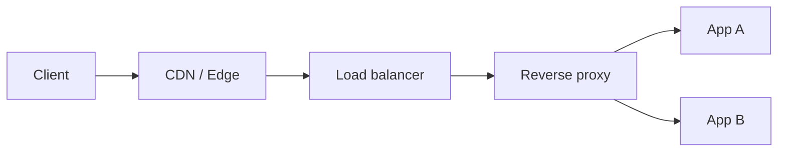

# Proxies, Reverse Proxies, Load Balancers, and CDNs

## What is it?

A forward proxy acts on behalf of clients. A reverse proxy acts in front of servers. Load balancers distribute traffic; CDNs cache and serve content close to users.

## Simple Explanation

A forward proxy is your assistant going out for you. A reverse proxy is a receptionist receiving visitors for a company. A load balancer chooses an available team member; a CDN stores copies near visitors.

## Hinglish Explanation

Forward proxy client-side perspective se hota hai; reverse proxy server-side se. Load balancer health checks ke basis par backend choose karta hai. CDN static ya cacheable content edge se deliver karke latency aur origin load reduce karta hai.

## Why Do We Need It?

They provide scalability, central TLS/auth policy, caching, routing, observability, and origin protection.

## How It Works

1. DNS may direct client to a CDN or load balancer address.
2. Edge checks cache/policy; miss goes to origin.
3. Reverse proxy terminates TLS or passes it through, applies routes/limits, and selects a healthy upstream.
4. Service response may be cached or returned to the client.

## Important Components / Terminology

| Term | Meaning |
|---|---|
| L4 load balancer | Routes TCP/UDP flows without HTTP semantics |
| L7 load balancer | Routes using HTTP host/path/header/cookie data |
| Health check | Test used to remove unhealthy targets |
| Cache hit/miss | Edge can/cannot serve stored response |
| Origin | Backend source behind CDN |

## Example

`api.example.com` can terminate TLS at an L7 balancer, route `/billing` to one service and `/search` to another, and add `X-Forwarded-For` under a trusted proxy policy.

## Real-World Example

Incorrect trust of client-supplied `X-Forwarded-For` lets users spoof IP-based decisions. Only accept forwarding headers inserted by known proxy hops.

## Important Properties

| Component | Main value | Risk/trade-off |
|---|---|---|
| Forward proxy | Client egress policy | Can inspect/limit client traffic |
| Reverse proxy | Server gateway | Adds hop/config complexity |
| Load balancer | Availability/scale | Health checks can be wrong |
| CDN | Lower latency/origin load | Cache invalidation/consistency |

### Common Misconceptions

* A reverse proxy is not identical to every load balancer.
* CDN caching is not always instant or appropriate for personalized data.
* Client IP needs careful forwarding-header trust.

### What Interviewers Usually Test

L4 versus L7 trade-offs, request path, health checks, caching, and scaling failures.

### Common Follow-up Questions

1. Proxy versus reverse proxy?
2. L4 versus L7 balancing?
3. How do health checks fail?
4. What is cache invalidation?
5. When use sticky sessions?

### Follow-up Answers

1. A forward proxy acts for clients reaching external services; a reverse proxy acts for servers receiving client traffic.
2. L4 balances TCP/UDP flows using lower-layer data; L7 understands application data such as HTTP host, path, headers, and cookies.
3. Probes can be too shallow, too strict, delayed, dependent on a failing shared system, or unable to distinguish overload from permanent failure.
4. Cache invalidation removes or marks old cached content stale so later users receive a refreshed representation.
5. Use sticky sessions only when connection or session state cannot be shared; prefer stateless/shared-state designs when possible.
