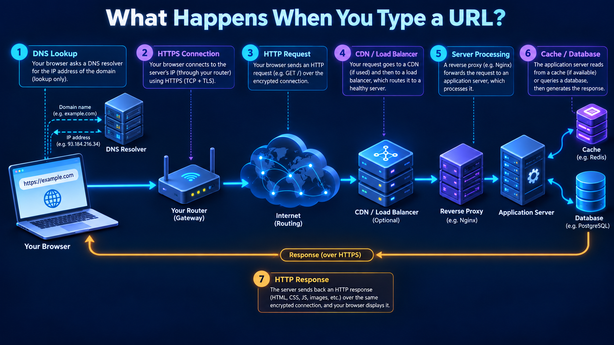

# What Happens When You Type a URL?

## What is it?

This is the end-to-end story that connects the knowledge base. Exact behaviour varies with caches, HTTP version, IPv4/IPv6, proxy policy, CDN, connection reuse, and browser implementation.

## Simple Explanation

The browser finds an address, gets the first local hop, reaches the service through routers, creates a secure connection, requests data, and renders the returned resources.

## Hinglish Explanation

URL type karte hi browser cache check karta hai, DNS se address leta hai, local gateway tak frame bhejta hai, routers path choose karte hain, phir TCP+TLS ya QUIC connection ke through HTTP request jaati hai. CDN/load balancer/backend response dete hain aur browser render karta hai.

## Why Do We Need It?

Interviewers use this flow to test whether you connect isolated protocols into one accurate system explanation.

## How It Works



1. Browser parses scheme, host, port, path; checks HSTS, cache, service worker, and pooled connections.
2. OS/browser resolves DNS from cache or resolver; returns A/AAAA and may select an address using policy.
3. Host checks route. For a remote destination it resolves the default gateway’s MAC (ARP for IPv4; Neighbor Discovery for IPv6) and sends a local frame.
4. Routers forward the IP packet hop by hop. At each routed hop the link frame changes; TTL/Hop Limit decreases.
5. For HTTPS, browser establishes TCP then TLS, or QUIC/TLS for HTTP/3. Certificate and hostname are validated.
6. Browser sends HTTP. CDN may answer from cache; otherwise edge/load balancer/reverse proxy forwards to an app.
7. App may use cache, database, or downstream services; response comes back over the connection.
8. Browser processes headers, decodes HTML, fetches dependent resources, runs JavaScript, performs layout/paint, and may reuse the connection.

```text
Browser → DNS cache/resolver → gateway → routers → CDN/LB → reverse proxy → app → cache/DB
   ↑                                                                            ↓
   └──────────────── encrypted HTTP response / resource fetches ───────────────┘
```

## Important Components / Terminology

| Component | Role in journey |
|---|---|
| DNS | Name-to-record lookup |
| ARP/ND | Local next-hop link resolution |
| TCP/QUIC | Transport connection/data delivery |
| TLS | Authenticated protected channel |
| CDN | Edge caching/traffic delivery |
| Reverse proxy | Server-facing request gateway |

## Example

Use `curl -v https://example.com` to observe resolution, connection, TLS, HTTP, and redirect details. Browser devtools adds waterfall timing for DNS, connect, TLS, request, and content phases.

## Real-World Example

A slow first page load can be DNS cache miss + TCP/TLS handshake + origin miss. Later navigations may reuse DNS, connections, TLS sessions, HTTP/2/3 streams, and CDN cache, making them much faster.

## Important Properties

| Variation | Effect |
|---|---|
| HTTP/3 | QUIC rather than TCP transport |
| CDN hit | Backend may not be contacted |
| Connection reuse | Handshakes skipped |
| IPv6 selected | Different route/path than IPv4 |

### Common Misconceptions

* DNS query is not normally sent “to the website server.”
* The remote server’s MAC is not used across routers.
* HTTPS does not necessarily mean a new TCP connection; HTTP/3 uses QUIC.

### What Interviewers Usually Test

A coherent step order plus practical caveats, without claiming every request always follows exactly the same path.

### Common Follow-up Questions

1. Where does ARP occur?
2. What can be cached?
3. TCP/TLS order versus HTTP/3?
4. What does a CDN change?
5. Why might first request be slower?

### Follow-up Answers

1. ARP occurs on the local IPv4 link when a host needs a neighbour’s MAC address, commonly the default gateway for a remote destination.
2. Browsers and intermediaries may cache DNS answers, connections, TLS sessions, HTTP responses, static assets, service-worker data, and CDN objects according to policy.
3. HTTPS over TCP normally establishes TCP first and TLS second; HTTP/3 uses QUIC over UDP with TLS 1.3 integrated into QUIC setup.
4. A CDN can serve cache hits near users, absorb traffic, apply edge policy, and fetch from origin on misses, changing latency and origin load.
5. The first request may need DNS, local neighbour resolution, connection/TLS setup, cache warm-up, and origin fetches that later requests reuse.
