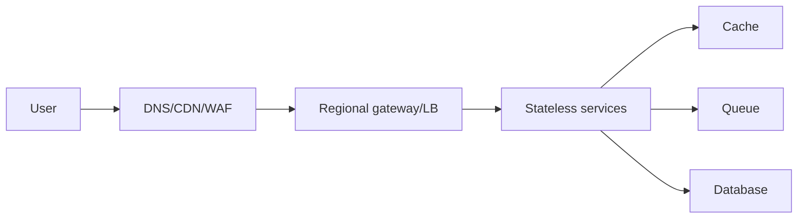

# Real-World Networking and System Design

## What is it?

System design networking turns protocols into production choices: latency budgets, load balancing, retries, service identity, connection management, caching, failure isolation, and observability.

## Simple Explanation

Good systems do not just “send requests.” They decide where traffic enters, how it is secured, where it is routed, what happens when a dependency fails, and how engineers can see the problem.

## Hinglish Explanation

System design mein networking components building blocks hain: DNS discover karta hai, CDN edge latency reduce karta hai, LB traffic distribute karta hai, proxy policies apply karta hai, TLS security deta hai, aur timeouts/retries failures control karte hain.

## Why Do We Need It?

Distributed services fail partially. Network design must protect users and dependencies while keeping latency, cost, and operational complexity acceptable.

## How It Works

1. Public DNS directs users to CDN or regional ingress.
2. WAF/rate limits/TLS termination protect and authenticate entry.
3. L7 balancing routes to healthy stateless service instances.
4. Services use bounded pools, deadlines, retries only where safe, and circuit breaking.
5. Private routing, identity, and authorization protect service-to-service calls.
6. Metrics/traces/logs expose DNS, connect, TLS, queue, and application timings.

## Important Components / Terminology

| Term | Meaning |
|---|---|
| Timeout/deadline | Maximum waiting time, propagated across calls |
| Retry budget | Limit that prevents retries causing a storm |
| Circuit breaker | Stops calls to persistently failing dependency |
| Connection pool | Reused outbound connections with bounded concurrency |
| Tail latency | Slowest percentile that harms user experience |

## Example

For a URL shortener, use CDN for redirects where cacheable, global DNS/anycast or regional ingress, TLS at edge, stateless redirect services, a replicated datastore, and monitoring for 3xx/4xx/5xx, RTT, and cache hit rate.

## Real-World Example

Retrying a non-idempotent payment after a timeout risks double charge because server may have completed work. Use an idempotency key, bounded retry, explicit timeout, and reconciliation—not blind retries.

## Important Properties

| Decision | Benefit | Trade-off |
|---|---|---|
| CDN | Lower user latency | Cache freshness complexity |
| L7 gateway | Rich routing/policy | CPU/TLS bottleneck risk |
| mTLS | Service identity | Certificate operations |
| Async queue | Failure absorption | Eventual consistency |

### Common Misconceptions

* Load balancing does not make a stateful, single database automatically scalable.
* Retries can worsen an outage.
* Private network location alone is not authorization.

### What Interviewers Usually Test

How you connect networking primitives to availability, latency, security, cost, and failure-mode trade-offs.

### Common Follow-up Questions

1. Where terminate TLS and why?
2. How route a multi-region API?
3. How prevent retry storms?
4. How scale WebSocket connections?
5. Which network metrics belong on a dashboard?

### Follow-up Answers

1. Terminate TLS at a trusted edge/gateway when central HTTP routing and certificate management help; use passthrough or re-encryption when end-to-end trust requirements need it.
2. Use global DNS/anycast or traffic management to choose healthy regional ingress, then pair it with an explicit data-replication and failover strategy.
3. Use bounded retries, exponential backoff with jitter, deadlines, idempotency, circuit breakers, and a retry budget shared across callers.
4. Horizontally scale gateway nodes, cap open connections, use pub/sub for cross-node fan-out, add heartbeats, and implement reconnect/backpressure behaviour.
5. Track DNS/connect/TLS/request latency percentiles, error rate, connection count, retransmissions/loss, saturation, queue depth, CDN hit ratio, and region/path dimensions.
