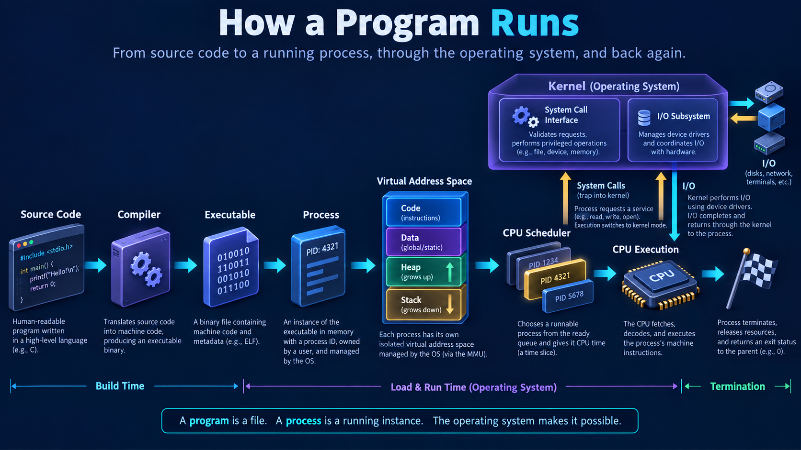
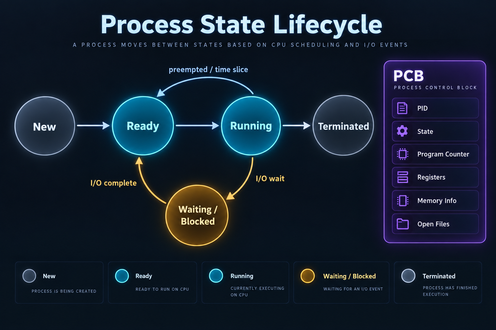
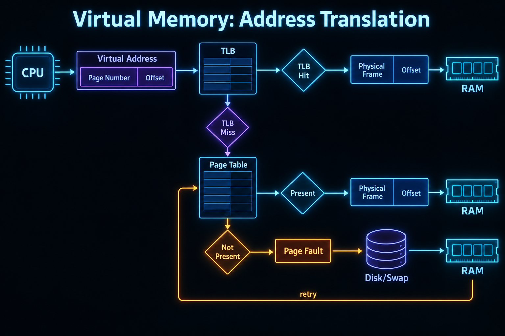

# Operating Systems Interview Preparation

This is a revision-first OS knowledge base for SDE, backend, systems, and campus interviews. Read the chapters in order once, then revise the workflows, command sheet, scenarios, and question bank.

## Learning path

| Stage | Chapters | Outcome |
|---|---|---|
| Beginner | 01–05 | Explain kernel, processes, threads, and scheduling |
| Concurrency | 06–11 | Reason about race conditions, locks, IPC, and deadlocks |
| Memory | 12–16 | Trace address translation, faults, and allocation |
| Storage & operations | 17–21 | Debug Linux processes, memory, files, and I/O |
| Systems thinking | 22–25 | Connect OS behaviour to backend/system design interviews |

## Visuals

## Speakable interview pattern

**Definition → Why → How → Example → Trade-off.** State the main idea in one sentence, trace what the OS does, then add one practical caveat. Good answers distinguish a program from a process, virtual from physical memory, and concurrency from parallelism.

## Topic map

1. [OS basics and architecture](01-os-basics-architecture.md)
2. [Kernel, modes, and system calls](02-kernel-modes-system-calls.md)
3. [Processes, PCB, and lifecycle](03-processes-pcb-lifecycle.md)
4. [Threads, process vs thread, context switching](04-threads-process-vs-thread-context.md)
5. [CPU scheduling](05-cpu-scheduling.md)
6. [Race conditions and critical sections](06-race-conditions-critical-sections.md)
7. [Mutexes, semaphores, monitors](07-mutexes-semaphores-monitors.md)
8. [Classic synchronization problems](08-classic-synchronization-problems.md)
9. [Deadlocks, starvation, livelock](09-deadlocks-starvation-livelock.md)
10. [Deadlock strategies and Banker’s algorithm](10-deadlock-strategies-bankers.md)
11. [IPC](11-ipc.md)
12. [Memory management and fragmentation](12-memory-management-fragmentation.md)
13. [Paging, segmentation, and TLB](13-paging-segmentation-tlb.md)
14. [Virtual memory, faults, and thrashing](14-virtual-memory-page-faults-thrashing.md)
15. [Page replacement](15-page-replacement.md)
16. [Stack, heap, and memory leaks](16-stack-heap-memory-leaks.md)
17. [File systems](17-file-systems.md)
18. [Storage and disk scheduling](18-storage-disk-scheduling.md)
19. [Boot, interrupts, I/O, drivers](19-boot-interrupts-io-drivers.md)
20. [Linux processes and commands](20-linux-processes-commands.md)
21. [OS troubleshooting scenarios](21-os-troubleshooting.md)
22. [What happens when a program runs?](22-program-runs.md)
23. [What happens when a Java program runs?](23-java-program-runs.md)
24. [OS in system design](24-os-system-design.md)
25. [100 interview questions](25-interview-questions.md)
