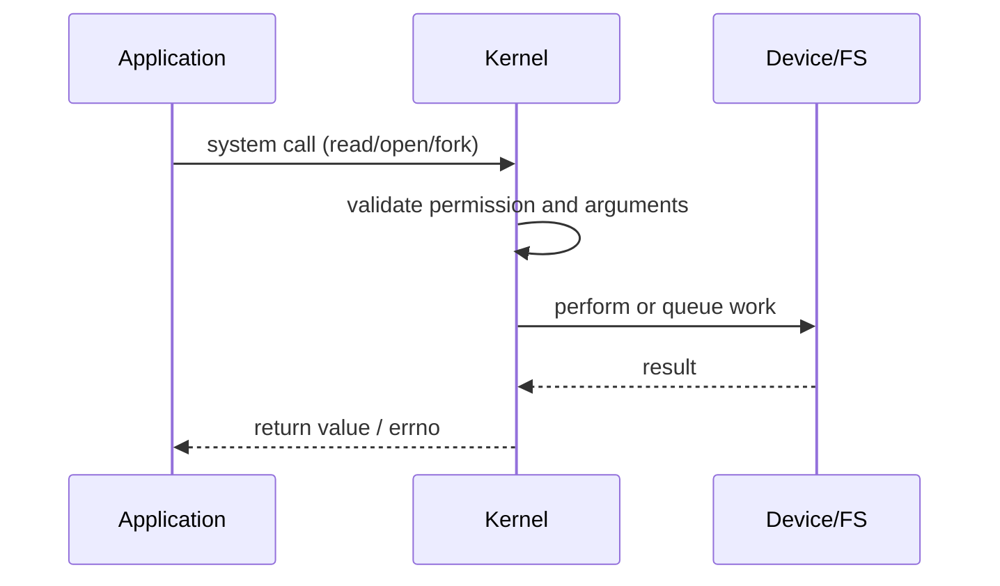

# Kernel, CPU Modes, and System Calls

## What is it?

The kernel runs with privileged access. User programs run with restricted access and use system calls to ask the kernel for protected operations such as file I/O, memory mapping, process creation, or networking.

## Simple Explanation

User mode is the public counter; kernel mode is the locked staff room. An app fills out a controlled request rather than walking into the staff room and touching the hardware itself.

## Hinglish Explanation

User-mode app privileged instruction directly execute nahi kar sakti. `read()`, `write()`, `fork()` jaise system calls controlled gate hain—CPU kernel mode mein enter karta hai, kernel validate karta hai, aur result app ko return karta hai.

## Why Do We Need It?

Mode separation prevents a buggy or malicious program from overwriting kernel memory, disabling interrupts, reading another process’s data, or directly programming a disk controller.

## How It Works

1. App calls a library wrapper such as `read(fd, buffer, n)`.
2. Wrapper executes a CPU instruction that enters the kernel through a defined entry point.
3. Kernel validates arguments, permissions, and object state.
4. Kernel performs or starts work through subsystems/drivers.
5. CPU returns to user mode with a result or error code.

## Important Terminology

| Term | Meaning |
|---|---|
| User mode | Restricted CPU privilege level for apps |
| Kernel mode | Privileged execution for OS core |
| System call | Controlled request from app to kernel |
| Trap/exception | Synchronous CPU event, often including syscall entry |
| Privileged instruction | CPU instruction allowed only in kernel mode |
| `errno` | Error indicator convention used by many Unix APIs |

## Example

`open()` asks the kernel to resolve a path and check permissions. It returns a file descriptor; later `read()` uses that descriptor to request bytes.

## Real-World Example

`strace -f -p <pid>` on Linux shows system calls a process makes. It is useful when a service appears stuck on `futex`, `read`, `connect`, or file operations.

## Important Properties

| Call type | Runs where | Can access hardware directly? |
|---|---|---|
| Ordinary function call | User process | No |
| System call | Enters kernel | Kernel performs privileged work |
| Interrupt handler | Kernel context | Yes, via kernel rules |

### Common Misconceptions

* A system call is not an ordinary function call, though a library may wrap it.
* Kernel mode is not automatically faster; it includes validation and may block.
* A system call does not always mean physical I/O happens immediately.

### What Interviewers Usually Test

Protection boundaries, syscall flow, and the difference between a trap, interrupt, function call, and mode switch.

### Common Follow-up Questions

1. Why are system calls expensive relative to function calls?
2. What is a privileged instruction?
3. Does `printf()` always make a system call?
4. What is `fork()`?
5. What can `strace` reveal?

### Follow-up Answers

1. They cross a protection boundary, save/restore state, validate input, and may block on kernel work or I/O.
2. It is an instruction, such as changing hardware control state, that the CPU permits only at a privileged level.
3. No. `printf()` may write to a user-space buffer and call `write()` only when the buffer flushes.
4. `fork()` creates a child process by duplicating the parent’s process context, typically using copy-on-write memory.
5. It shows system calls, arguments, return values, errors, and often where a process is waiting.
