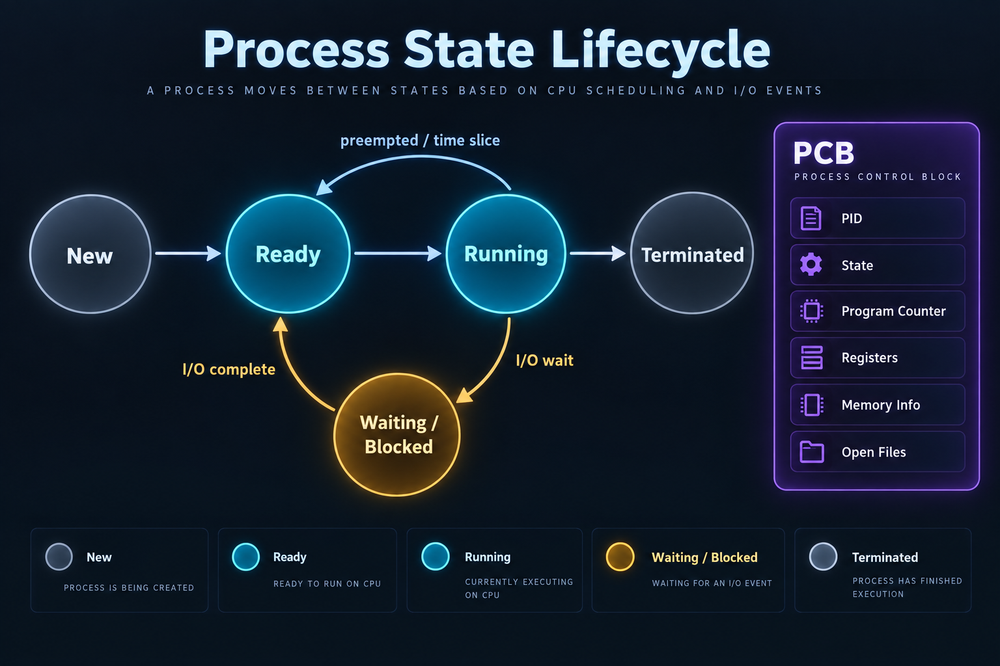

# Processes, PCB, and Lifecycle

## What is it?

A program is passive code on disk; a process is one running instance of that program with an address space, execution state, open resources, and a kernel record called a Process Control Block (PCB).

## Simple Explanation

The recipe is a program; a restaurant currently cooking it is a process. The PCB is the manager’s record of which table it serves, what it was doing, and what resources it owns.

## Hinglish Explanation

Executable file program hai. Jab OS usko load karke PID, memory, registers, files, scheduler state deta hai, tab woh process banta hai. PCB mein kernel process ki important information rakhta hai.

## Why Do We Need It?

Processes isolate applications, allow multiple copies of the same program, and let the scheduler pause/resume work safely. The OS needs stored state because CPU executes only one thread per core at a moment.

## How It Works



1. A parent calls `fork()` or a launcher asks the kernel to create a process.
2. Kernel assigns PID and PCB, then creates virtual address-space state.
3. A ready thread waits until scheduler dispatches it to a CPU.
4. It may run, block for I/O/lock, return to ready, exit, or be terminated.
5. Parent can `wait()` to collect exit status; otherwise a finished child may remain a zombie briefly.

```text
New → Ready → Running → Terminated
                │  ▲
                ▼  │ I/O complete
           Waiting / Blocked
```

## Important Terminology

| Term | Meaning |
|---|---|
| PID | Process identifier |
| PCB | Kernel record: state, registers, memory, files, scheduling info |
| Ready | Able to run, waiting for CPU |
| Blocked | Waiting for I/O, lock, timer, or event |
| Zombie | Exited child whose status has not been collected |
| Orphan | Child whose parent exited; adopted by another process |
| Daemon | Long-running background service process |

## Example

In a shell, `python server.py &` creates a background process. `ps -ef` can show its PID and parent PID; `wait` lets a parent consume a child’s exit status.

## Real-World Example

Nginx, PostgreSQL, and application workers may use separate processes for isolation or privilege separation. A parent process often supervises/restarts child workers.

## Important Properties

| State | Has CPU now? | Typical reason |
|---|---:|---|
| Ready | No | Waiting for scheduler |
| Running | Yes | Executing instructions |
| Blocked | No | Awaiting event/I/O/lock |
| Zombie | No | Awaiting parent reap |

### Common Misconceptions

* A zombie is not a running CPU-hungry process; it mostly occupies a process-table entry.
* An orphan is not necessarily broken; init/systemd can adopt it.
* Ready and blocked are different: ready can run immediately if scheduled.

### What Interviewers Usually Test

Program-vs-process precision, state transitions, PCB contents, and Linux `fork`/`exec`/`wait` lifecycle.

### Common Follow-up Questions

1. What happens in `fork()` then `exec()`?
2. Why do zombies exist?
3. How do you remove a zombie?
4. What is copy-on-write?
5. Ready versus running?

### Follow-up Answers

1. `fork()` makes a child process; `exec()` replaces that child’s program image with another executable while keeping its PID.
2. They retain an exit code and accounting information until the parent can collect it with `wait()`.
3. The parent must reap it with `wait`; if parent is broken, restart/terminate the parent so an adopter can reap children.
4. Parent and child initially share memory pages read-only; a page is copied only when one writes to it.
5. Ready is runnable but not chosen; running is currently executing on a CPU core.
