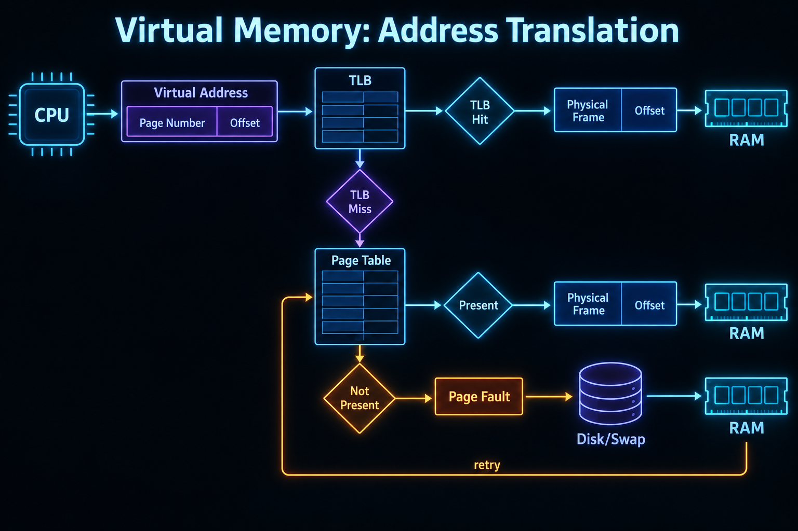

# Paging, Segmentation, and TLB

## What is it?

Paging splits virtual memory into fixed-size pages and RAM into equal-size frames. Segmentation groups memory by logical variable-size regions. A Translation Lookaside Buffer (TLB) caches recent page-table translations.

## Simple Explanation

Paging is a book divided into equal pages placed in any shelf slot. Segmentation is keeping whole chapters of different sizes together. The TLB is a tiny fast bookmark of recently used page locations.

## Hinglish Explanation

Paging mein virtual address page number aur offset mein split hota hai. Page table page ko physical frame se map karta hai. TLB recent mappings ka fast cache hai. Segmentation logical units jaise code/data/stack ko variable-size segments mein represent kar sakta hai.

## Why Do We Need It?

Paging enables noncontiguous physical allocation and protection. Page tables create per-process mappings. TLB avoids an expensive page-table memory walk for every load/store.

## How It Works



1. CPU creates virtual address = page number + offset.
2. MMU checks TLB for page-number mapping.
3. On hit, it joins frame number with unchanged offset and accesses RAM.
4. On miss, hardware/software walks page table, checks valid/protection bits, then fills TLB.
5. If page is absent, a page fault enters kernel; it loads/replaces a page and retries instruction.

```text
Virtual address: [ page number | offset ]
TLB/page table: page number → physical frame
Physical address: [ frame number | same offset ]
```

## Important Terminology

| Term | Meaning |
|---|---|
| Page | Fixed-size virtual-memory block |
| Frame | Equal-size physical-RAM block |
| PTE | Page-table entry: frame, permissions, present/dirty/accessed bits |
| TLB hit/miss | Translation found/not found in fast cache |
| Multi-level page table | Hierarchical table to avoid allocating flat table for unused ranges |
| Segment | Variable-size logical memory region |

## Example

With 4 KiB pages, the lower 12 bits of a virtual address are the offset. The page-table mapping changes the page/frame part, while the offset remains unchanged.

## Real-World Example

Large working sets and frequent context/address-space changes can reduce TLB hit rate. Databases may use huge pages for some memory regions to reduce translation overhead, with operational trade-offs.

## Important Properties

| Concept | Paging | Segmentation |
|---|---|---|
| Unit size | Fixed | Variable |
| External fragmentation | Avoided for frames | Possible |
| Logical visibility | Less explicit | Natural code/data segments |
| Modern use | Core mechanism | Often hardware/ABI-specific or combined |

### Common Misconceptions

* TLB is a cache of address translations, not a cache of normal program data.
* TLB miss is not automatically a page fault.
* A page and a frame have the same size but different roles.

### What Interviewers Usually Test

Address-translation flow, offset invariance, TLB-vs-page-fault distinction, and paging-vs-segmentation trade-offs.

### Common Follow-up Questions

1. TLB miss versus page fault?
2. Why multi-level page tables?
3. Why is offset unchanged?
4. Page versus frame?
5. What is a valid/present bit?

### Follow-up Answers

1. TLB miss means translation is not cached and page table must be checked; page fault means the page table says required page is not resident/accessible.
2. They allocate lower-level tables only for used virtual ranges, reducing page-table memory for sparse address spaces.
3. Offset selects a byte within a fixed-size page; the mapped frame has the same size, so that byte position stays the same.
4. Page is virtual-address-space unit; frame is physical-RAM unit that stores a page.
5. It indicates whether a mapping is currently valid/resident; access to an absent page causes fault handling.
