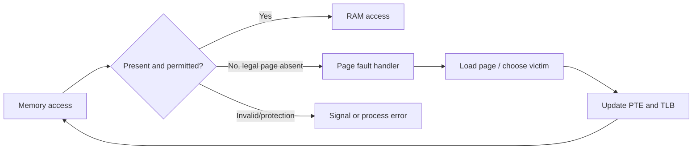

# Virtual Memory, Page Faults, and Thrashing

## What is it?

Virtual memory lets a process use a large protected address space while only needed pages are resident in RAM. Demand paging loads pages on use. A page fault occurs when the required mapping is absent or violates protection; thrashing is excessive paging that destroys useful work.

## Simple Explanation

RAM is your desk; disk is a slow storeroom. Virtual memory lets you own many folders, but only active folders stay on the desk. If you keep fetching and returning folders instead of working, you are thrashing.

## Hinglish Explanation

Demand paging mein page tabhi RAM mein aata hai jab actually use ho. Missing page par page fault hota hai; OS disk/swap se page laata hai. Agar working set RAM se bada ho, system mostly page-in/page-out karega—isko thrashing bolte hain.

## Why Do We Need It?

It improves RAM utilisation, supports large/sparse address spaces, isolates processes, and loads programs lazily. But disk is vastly slower than RAM, so locality and memory limits matter.

## How It Works

1. CPU references virtual page; PTE says not present.
2. Hardware traps to kernel page-fault handler.
3. Kernel checks whether access is legal; invalid access can signal/crash process.
4. If legal but absent, OS finds free frame or selects victim page.
5. Dirty victim is written back if needed; target page is read from file/swap.
6. Page table/TLB update; faulting instruction restarts.

## Important Terminology

| Term | Meaning |
|---|---|
| Demand paging | Load page only when referenced |
| Swap | Disk area/file used for evicted anonymous pages |
| Page-in/page-out | Read page into / evict page from RAM |
| Working set | Pages actively needed over a recent time window |
| Locality | Tendency to reuse nearby/recent addresses |
| Thrashing | Page-fault rate so high CPU waits on storage |

## Example

A container with 512 MiB limit starts a large Java heap plus caches. Once its working set exceeds available memory, reclaim/swap may spike; if cgroup limit is exceeded, Linux OOM logic can kill a process.

## Real-World Example

Memory pressure is diagnosed with `free -h`, `vmstat 1`, process RSS/PSS, page-fault counters, swap activity, and kernel logs. “Used memory” alone is not enough because Linux intentionally uses page cache.

## Important Properties

| Event | Meaning | Cost |
|---|---|---|
| Minor fault | Mapping/page already in RAM or cheaply resolved | Lower |
| Major fault | Must wait for storage I/O | High |
| Thrashing | Working set cannot fit | Very high latency/low throughput |

### Common Misconceptions

* A page fault is normal and not always an error.
* Virtual memory is not simply “disk pretending to be RAM.”
* Free RAM is not the only healthy-memory metric; reclaimable cache is useful.

### What Interviewers Usually Test

Fault handling sequence, legal-vs-invalid access, locality, working sets, and why memory pressure hurts tail latency.

### Common Follow-up Questions

1. Minor versus major fault?
2. What is swap?
3. Why can page fault be normal?
4. What causes thrashing?
5. What is OOM killer?

### Follow-up Answers

1. Minor faults are resolved without storage I/O; major faults require reading data from storage and are much slower.
2. Swap is disk-backed space used for some evicted anonymous memory pages; it trades latency for memory capacity.
3. A valid page may simply not be resident yet due to lazy allocation or demand paging; the OS loads/maps it and restarts execution.
4. Too many active pages for available RAM, excessive multiprogramming, memory leaks, or poorly sized workloads cause constant replacement.
5. On Linux, it is a last-resort mechanism that selects a process to kill when memory cannot be reclaimed sufficiently.
