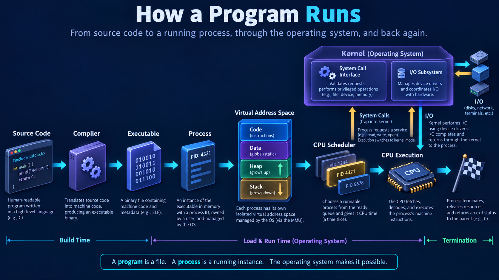

# What Happens When a Program Runs?

## What is it?

This is the end-to-end execution story: source code becomes an executable, the OS creates a process and virtual address space, scheduler runs its threads, kernel provides I/O through system calls, and the process exits with status.

## Simple Explanation

Writing code creates a blueprint. Compilation creates a machine-readable product. Launching creates a live worker with memory and CPU turns; the worker asks the OS whenever it needs protected resources.

## Hinglish Explanation

Source code compile hoke executable banta hai. Shell/launcher `exec` ke through process image load karwata hai. OS virtual address space, stack, heap aur files set karta hai. Scheduler CPU deta hai; system calls kernel se I/O karwate hain; exit par resources cleanup hote hain.

## Why Do We Need It?

Interviewers ask this to check whether you can connect compiler output, loader, virtual memory, scheduling, syscalls, I/O, and termination as one accurate workflow.

## How It Works



1. Compiler/linker produce executable with code, data, symbols, and shared-library references.
2. Shell/parent creates child and calls `execve`; kernel validates format/permissions.
3. Loader maps executable/shared libraries into virtual address space: code, data, heap, stack, memory mappings.
4. Kernel creates initial thread state and puts it in ready queue.
5. Scheduler dispatches it; CPU executes instructions and translates addresses through MMU/TLB/page tables.
6. File/network/time/process requests cross to kernel through system calls.
7. Devices use drivers/DMA/interrupt completion; thread may block then become ready.
8. `exit` releases resources; parent can read status via `wait`.

```text
source → compiler/linker → executable → execve
      → process + virtual address space → scheduler → CPU
      → system calls ↔ kernel/drivers ↔ I/O → exit/wait
```

## Important Terminology

| Term | Meaning |
|---|---|
| Executable | File containing code/data and loader metadata |
| Loader | Maps program and libraries, prepares initial process state |
| `execve` | Unix syscall replacing process image with new program |
| Dynamic linker | Loads/resolves shared libraries at startup/lazy binding |
| Exit status | Small result code collected by parent |

## Example

Running `./app` from Bash typically makes shell `fork`, child `execve("./app", ...)`, then parent waits or returns prompt for background jobs. `strace -f ./app` reveals this lifecycle.

## Real-World Example

Container entrypoint is still a process. If PID 1 does not reap children or handle signals correctly, zombie processes and slow shutdowns can appear in a container despite orchestration.

## Important Properties

| Stage | OS role |
|---|---|
| Load | Validate/map executable and libraries |
| Run | Schedule threads, translate/protect memory |
| I/O | Check access, buffer/queue, use drivers |
| Exit | Release resources and publish status |

### Common Misconceptions

* Compilation does not itself make a running process.
* `exec` does not create a new PID; it replaces current process image.
* Most binary pages can be loaded lazily, not necessarily all copied into RAM at launch.

### What Interviewers Usually Test

The order of process loading/execution and correct links among loader, memory, scheduler, syscalls, interrupts, and exit handling.

### Common Follow-up Questions

1. `fork` versus `exec`?
2. What does loader map?
3. What starts execution first?
4. Why can a program block?
5. What happens at `exit`?

### Follow-up Answers

1. `fork` creates a child process; `exec` replaces a process’s program image with a new executable.
2. Executable code/data, shared libraries, stack, heap/mappings, and metadata needed for initial execution.
3. The loader/kernel sets initial instruction pointer to program entry/startup code, which eventually calls language runtime and `main`.
4. It may wait for disk/network I/O, a lock, timer, child process, socket, or another kernel event.
5. Kernel closes resources, records status, releases most process state, and keeps a zombie record until parent waits.
