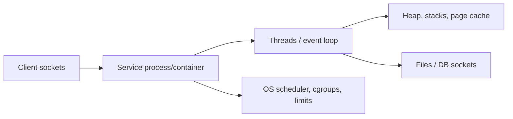

# Operating Systems in Backend and System Design

## What is it?

OS concepts determine how backend services behave under load: processes isolate failure, threads/tasks provide concurrency, virtual memory limits capacity, filesystems persist data, sockets connect services, and scheduling/locks shape latency.

## Simple Explanation

System design diagrams show boxes and arrows; OS concepts explain what happens inside each box when 10,000 users arrive, memory fills, a disk slows, or one worker gets stuck.

## Hinglish Explanation

Architecture sirf services ka diagram nahi. Har service process/thread count, connection pool, heap/RSS, file descriptors, CPU quota, disk I/O aur locks ke through real machine par run karti hai. OS limits ignore karoge toh design load par fail hoga.

## Why Do We Need It?

Capacity, tail latency, safety, and cost depend on these details. A “stateless scalable API” can still fail through file-descriptor exhaustion, CPU queueing, GC pauses, lock contention, or memory-limit OOM.

## How It Works

1. Deploy service as process/container with CPU, memory, PID, I/O, and file-descriptor limits.
2. Accept requests through sockets; runtime maps them to threads/event loop/tasks.
3. Scheduler allocates CPU; queues and locks coordinate work.
4. Heap/page cache/filesystem/database buffers use memory and I/O.
5. Metrics and kernel signals reveal saturation; autoscaling/backpressure/limits keep failure contained.

## Important Terminology

| Design concern | OS connection |
|---|---|
| Worker pool | Threads, queues, context switches |
| Container isolation | Namespaces, cgroups, kernel limits |
| Connection pool | Sockets, FDs, waiting/backpressure |
| Cache | Heap/RSS/page cache, eviction |
| Rate limit | Concurrency/semaphore/queue bound |
| Graceful shutdown | Signals, draining, child reaping |

## Example

For a Java API, set request deadlines, bound worker/connection pools, budget heap plus native memory under cgroup limit, export CPU/RSS/GC/FD metrics, and use a queue/circuit breaker to keep overload from becoming OOM.

## Real-World Example

An unbounded executor queue hides overload until it consumes heap and causes long GC pauses or OOM. A bounded queue with rejection/backpressure makes failure visible early and protects the process.

## Important Properties

| Choice | Benefit | Trade-off |
|---|---|---|
| More threads | More I/O concurrency | Stack memory, contention, switching |
| More cache | Lower backend load | Memory pressure/staleness |
| Process isolation | Fault containment | IPC/resource overhead |
| Async I/O | Fewer blocked threads | State-machine complexity |

### Common Misconceptions

* More threads do not always increase throughput; CPU-bound workloads can slow from contention.
* Containers are not VMs and do not have their own kernel by default.
* A timeout alone does not free work unless cancellation/cleanup is designed.

### What Interviewers Usually Test

Whether you translate OS primitives into capacity, failure-mode, isolation, and observability decisions for real services.

### Common Follow-up Questions

1. How size thread pool?
2. Why bound queues?
3. What limits matter in container?
4. Process versus thread worker model?
5. How design graceful shutdown?

### Follow-up Answers

1. Measure workload: CPU-bound pools stay near core count; I/O-bound pools can be larger but must be capped by memory, downstream capacity, and latency targets.
2. Bounds apply backpressure and prevent memory growth that turns overload into an OOM outage.
3. CPU quota, memory/cgroup limit, PID limit, file-descriptor limit, network/I/O limits, and ephemeral storage all affect capacity.
4. Processes give stronger isolation and crash containment; threads share memory with lower communication cost but need synchronization.
5. Stop accepting new work, drain/finish bounded in-flight work, close resources, handle termination signals, and exit before orchestrator deadline.
